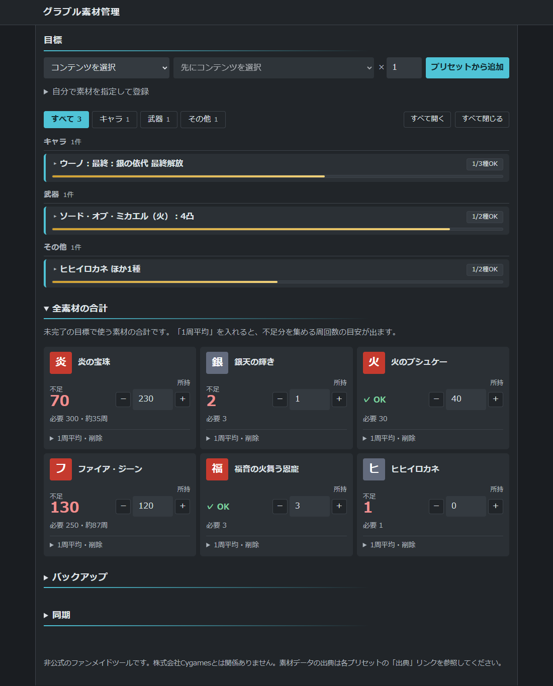
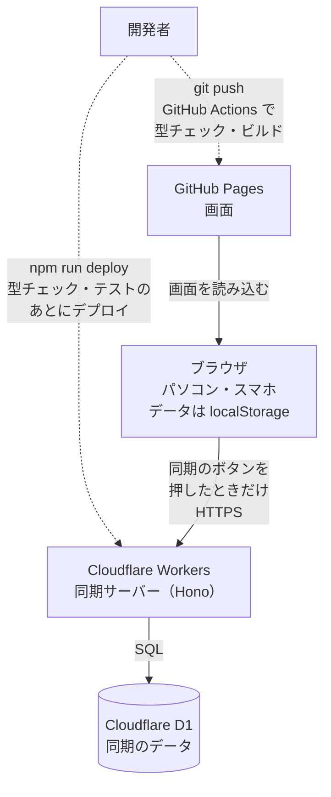

# グラブル素材管理

グランブルーファンタジーの上限解放などに必要な素材の数を管理するツールです。ブラウザで開いて使います。



## 機能
- 目標（例: 十天衆の最終上限解放）ごとに必要な素材を登録し、所持数から不足数を出す
- 全目標の不足数をまとめて表示し、1周あたりのドロップ数から周回数の目安を出す
- 目標を完了すると、使った素材を所持数から差し引く
- データをJSONファイルに書き出し・読み込みできる
- 同期コードを使って、パソコンとスマホなどの間でデータを送ったり取ってきたりできる

## 使い方
https://syugo1142.github.io/gbf-tracker/ を開きます。

データはブラウザのlocalStorageに保存します。ブラウザのデータを消すと消えるので、「バックアップ」から書き出しておいてください。

### 同期
1. 1台目で「同期」を開き、「新しく作る」を押して同期コードを作り、「サーバーに送る」を押します
2. 「コピー」で同期コードをコピーし、2台目の「同期」の欄に貼り付けて、「サーバーから取ってくる」を押します

- 自動では同期しません。データを書き換えたら「サーバーに送る」を押し、もう1台で「サーバーから取ってくる」を押してください。データを同期サーバー（Cloudflare Workers）に送るのは、「サーバーに送る」を押したときだけです
- 送るとサーバーのデータが、取ってくると端末のデータが上書きされます。もう1台で書き換えたあとは、送る前に先に取ってきてください
- 素材のアイコンは送りません。端末ごとに登録してください
- 同期コードを知っている人は、データを読み書きできます。人に教えないでください
- サーバーのデータは「サーバーから消す」で消せます（端末のデータは残ります）。180日間送られなかったデータは、自動で消えます

## 収録プリセット
全636件です。

| 分類 | 対象 | 内容 |
|---|---|---|
| キャラ | 十天衆 | 最終上限解放（銀の依代・依代6種・黄金の依代・最終）、限界超越 Lv110〜150 |
| キャラ | 天星器（十天衆加入） | 属性ごとに第1〜9段階（第3段階の設備拡充は初回のみ） |
| キャラ | 十賢者 | アーカルム召喚石の交換〜5凸、加入、至賢の領域、礎武器の交換〜5凸、最終上限解放、4アビ。限界超越 Lv110 はマリア・テレサとカイムのみ |
| 武器 | 天司武器 / エニアド / 六竜武器 | 4凸 |
| 武器 | レヴァンスウェポン | 4凸、覚醒Lv1→15、特殊強化（リビルド）、覚醒Lv15→20 |
| 武器 | 終末武器 | 交換、4凸、第2スキル付与、5凸、第3スキル付与、限界超越 Lv210〜250 |
| 武器 | ドラゴニックウェポン | 交換、4凸、5凸、特殊強化 |

段階が複数あるものには「全段階まとめて」もあります。

- 必要数の出典は [GameWith](https://xn--bck3aza1a2if6kra4ee0hf.gamewith.jp/) の各記事です（各プリセットの「出典」リンク）
- アップデートで必要数が変わることがあります。実際の数はゲーム内で確認してください

## 使用技術
- フロントエンド: TypeScript、[Vite](https://vite.dev/)
- バックエンド: TypeScript、[Hono](https://hono.dev/)、node:test（API のテスト）
- データベース: [Cloudflare D1](https://developers.cloudflare.com/d1/)（SQLite）
- インフラ・CI/CD: GitHub Pages（画面のホスティング）、[Cloudflare Workers](https://developers.cloudflare.com/workers/)（同期サーバーのホスティング）、GitHub Actions（型チェック・同期サーバーのテスト、画面のビルド・デプロイ）、Wrangler（同期サーバーのテスト・デプロイ）

## 構成

画面はブラウザの中だけで動きます。同期サーバーを使うのは、同期のボタンを押したときだけです。

## 開発
Node.js 24 以降が必要です。
```
npm ci             # 必要な部品（Vite、TypeScript、Hono、Wrangler など）を入れる
npm run dev        # 画面の開発用サーバーを起動する（http://localhost:5173/）
npm run build      # デプロイするファイルを dist/ に作る
npm run db:migrate # 手元の同期サーバー用のデータベースに表を作る（初めてのときと、表を変えたとき）
npm start          # 同期サーバーを手元で起動する（http://localhost:3000。npm run dev の画面の「同期」はここにつながる）
npm run typecheck  # 型の間違いがないか確かめる
npm test           # 同期サーバーの API を自動でテストする（test/server.test.ts）
npm run deploy     # 型チェックとテストに通ったら、同期サーバーを Cloudflare Workers にデプロイする
```
main に push すると、GitHub Actions が型チェックとテストを行い、画面をビルドして GitHub Pages にデプロイします。同期サーバーは push ではデプロイされないので、`npm run deploy` でデプロイします。

テストは、同期サーバーを Workers と同じ仕組み（workerd）で動かし、テスト用のデータベースを使います。開発用のデータベースには触りません。

## 関連ツール
- [グラブル天井計算](https://syugo1142.github.io/gbf-tenjou-keisan/)（[リポジトリ](https://github.com/syugo1142/gbf-tenjou-keisan)）: 宝晶石とチケットから、天井までの残りを計算する

## 注意
- 非公式のツールです。株式会社Cygamesとは関係ありません。
- ゲームの操作や通信には関与しません。数はすべて手入力です。
- ゲームの画像はリポジトリに含めていません。
