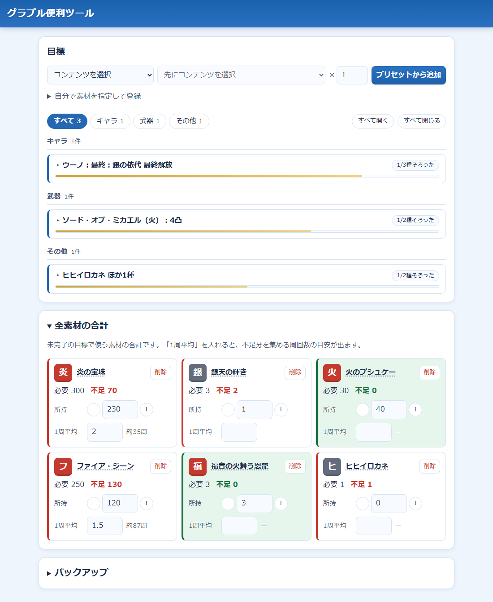

# グラブル便利ツール

グランブルーファンタジーの上限解放などに必要な素材の数を管理するツールです。ブラウザで開いて使います。



## 機能
- 目標（例: 十天衆の最終上限解放）ごとに必要な素材を登録し、所持数から不足数を出す
- 全目標の不足数をまとめて表示し、1周あたりのドロップ数から周回数の目安を出す
- 目標を完了すると、使った素材を所持数から差し引く
- データをJSONファイルに書き出し・読み込みできる

## 使い方
https://syugo1142.github.io/gbf-tracker/ を開きます。

データはブラウザのlocalStorageに保存し、サーバーには送りません。ブラウザのデータを消すと消えるので、「バックアップ」から書き出しておいてください。

## 収録プリセット
全636件です。

| 分類 | 対象 | 内容 |
|---|---|---|
| キャラ | 十天衆 | 最終上限解放（銀の依代・依代6種・黄金の依代・最終）、限界超越 Lv110〜150 |
| キャラ | 天星器（十天衆加入） | 属性ごとに第1〜9段階（第3段階の設備拡充は初回のみ） |
| キャラ | 十賢者 | アーカルム召喚石の交換〜5凸、加入、至賢の領域、礎武器の交換〜5凸、最終上限解放、4アビ。限界超越 Lv110 はマリア・テレサとカイムのみ |
| 武器 | 天司武器 / エニアド / 六竜武器 | 4凸 |
| 武器 | レヴァンスウェポン | 4凸、覚醒Lv1→15、特殊強化（リビルド）、覚醒Lv15→20 |
| 武器 | 終末武器 | 交換、4凸、第2スキル付与、5凸、第3スキル付与、限界超越 Lv210〜250 |
| 武器 | ドラゴニックウェポン | 交換、4凸、5凸、特殊強化 |

段階が複数あるものには「全段階まとめて」もあります。

- 必要数の出典は [GameWith](https://xn--bck3aza1a2if6kra4ee0hf.gamewith.jp/) の各記事です（各プリセットの「出典」リンク）
- アップデートで必要数が変わることがあります。実際の数はゲーム内で確認してください

## 開発
画面は [Vite](https://vite.dev/) でビルドしています。Node.js 24 以降が必要です。
```
npm ci            # 開発用の道具（Vite、TypeScript など）を入れる
npm run dev       # 開発用サーバーを起動する（http://localhost:5173/）
npm run build     # 公開用のファイルを dist/ に作る
npm run preview   # ビルドしたものを手元で確かめる
npm start         # 同期サーバーを起動する（作成中。http://localhost:3000/api/hello）
npm run typecheck # 型の間違いがないか確かめる
```
main に push すると、GitHub Actions がビルドして GitHub Pages に公開します。

## 関連ツール
- [グラブル天井計算](https://syugo1142.github.io/gbf-tenjou-keisan/)（[リポジトリ](https://github.com/syugo1142/gbf-tenjou-keisan)）: 宝晶石とチケットから、天井までの残りを計算する

## 注意
- 非公式のツールです。株式会社Cygamesとは関係ありません。
- ゲームの操作や通信には関与しません。数はすべて手入力です。
- ゲームの画像はリポジトリに含めていません。
